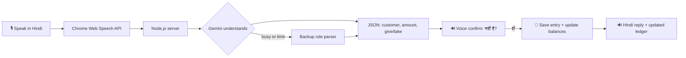

<div align="center">

# 🌾 Kisan Khata (किसान खाता)

### *"बोलिए, हिसाब अपने आप लिखा जाएगा"*
**A Hindi voice ledger for shopkeepers who keep their credit book in their head.**

🎙️ Voice in &nbsp;•&nbsp; 🔊 Voice out &nbsp;•&nbsp; ✅ Voice confirm &nbsp;•&nbsp; 📒 Real ledger

**[🚀 Live demo](https://kisan-khata.onrender.com)** &nbsp;|&nbsp; **[🎬 Demo video](PASTE_DRIVE_LINK_HERE)**

</div>

---

## 👨‍🌾 The story behind it
My father runs an agriculture business. Every day, farmers take khaad, beej and dawai on credit (*udhaar*). He remembers who owes what, and when to ask for it, **entirely in his head**.

He doesn't type. Paper registers get lost, and it's easy to forget an old amount. Small shops lose real money this way.

So I built the one thing he can already do: **talk**.

---

## 🗣️ Just speak, like talking to a customer

| He says | The app does |
|---|---|
| *"रमेश को 20 बोरी खाद दी, 8000 बाकी, सोमवार को पैसे माँगना"* | Adds ₹8,000 to Ramesh's account and saves a reminder for Monday |
| *"रमेश ने 3000 रुपये दिए"* | Reduces Ramesh's balance |
| *"आज किससे पैसे लेने हैं?"* | Speaks a briefing of who to collect from |

After every entry, the app **speaks back in Hindi** and shows the updated ledger.

---

## ✅ Why voice confirm matters
Speech recognition can mishear a number, and a wrong number in a ledger is a **real loss**.

So before saving, the app asks:

> 🔊 *"रमेश, ₹8000, सही है?"*

and waits for **"हाँ"** or **"नहीं"** (or a tap on ✅ / ❌). **Nothing is saved without a yes.**

---

## ⚙️ How it works



---

## 🔍 What is real and what is not (being honest)

| | Status |
|---|---|
| Voice input and voice output | ✅ Real |
| Gemini understanding the sentence | ✅ Real |
| Saving entries and calculating balances | ✅ Real |
| Voice confirm before saving | ✅ Real |
| Morning briefing button | ✅ Real, uses simple rules (no Gemini call) |
| Backup parser when Gemini is busy | 🛟 Simple rule-based fallback, less accurate than Gemini |
| Data storage | ⚠️ A JSON file, so free hosting may reset it |

This is a 6-hour solo build, not a finished product. Speech works best in **Google Chrome**.

---

## 🧪 Try it in 1 minute
1. Open the live demo in **Chrome** and allow the microphone.
2. Tap 🎙️ and say: *"रमेश को 20 बोरी खाद दी, 8000 बाकी"*
3. Say **"हाँ"** when the app asks "सही है?"
4. Say: *"रमेश ने 3000 रुपये दिए"*, then confirm again.
5. Tap **☀️ आज का हिसाब सुनाओ** to hear the briefing.

No mic? Use the type box or tap an example sentence.

---

## 🛠️ Tech
Node.js • Express • Gemini API • Web Speech API (voice in) • Speech Synthesis (voice out) • Plain HTML, CSS and JavaScript

## 💻 Run locally
```bash
npm install
```
Create a `.env` file:
```
GEMINI_API_KEY=your_key_here
GEMINI_MODEL=your_model_name
```
Then:
```bash
npm start
```
Open http://localhost:3000 in Chrome.

---

## 🔮 What I would build next
- A proper database, so data never resets
- WhatsApp or SMS payment reminders sent to customers
- Tap a customer to see their full history
- More Indian languages and a version for any kind of shop

---

<div align="center">

Built solo by **Avni Sharma** 💚
*for every shopkeeper who remembers everything, except where he wrote it down.*

</div>